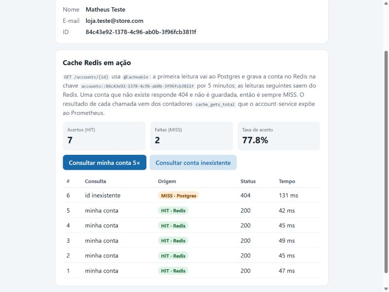
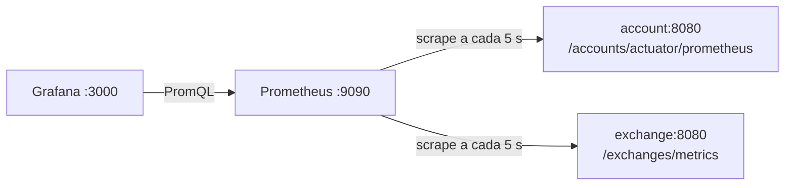
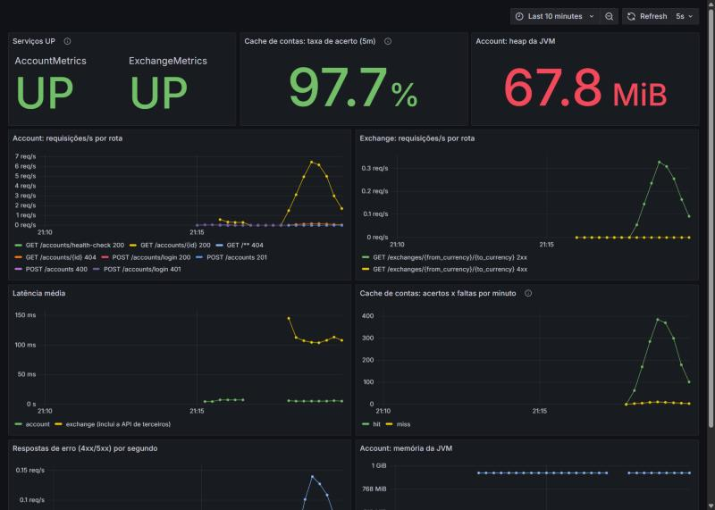

# Bottlenecks

O curso lista cinco bottlenecks: caching, observability, messaging, load balancing e vulnerability scanning. Cada integrante entrega ao menos dois.

| Bottleneck | Responsável | Onde |
|---|---|---|
| Caching (Redis no Account) | Matheus | `api/compose.yaml`, `pma-account-service` |
| Observability (Prometheus e Grafana) | Matheus | `api/setup/prometheus`, `api/setup/grafana` |
| Load balancing | Douglas | `api/setup/nginx/nginx.conf`, `api/compose.yaml`, HPA no EKS |
| Vulnerability scanning | Douglas | estágio `Scan Image` nos `Jenkinsfile` do Gateway e do Auth |

## Caching (Matheus)

**Problema.** Toda leitura de conta vai ao PostgreSQL. E não é só `GET /accounts/{id}`: a cada página aberta o front-end chama `GET /auth/me`, e o Auth busca a conta no Account. A mesma linha do banco é lida de novo a cada clique, por todos os usuários.

**Solução.** Cache *read-through* com Redis no `account-service`, como no hands-on 8:

``` java
// AccountService
@Cacheable(value = "accounts", key = "#id")       // 1ª leitura: Postgres -> grava no Redis
public Account findById(String id) {
    return accountRepository.findById(id)
        .map(AccountModel::to)
        .orElseThrow(() -> new ResponseStatusException(HttpStatus.NOT_FOUND, "Account not found"));
}

@CacheEvict(value = "accounts", key = "#id")      // conta apagada não pode continuar no cache
public void delete(String id) { ... }
```

``` yaml
# application.yaml
spring:
  data.redis.host: ${REDIS_HOST:localhost}
  cache:
    type: redis
    cache-names: accounts
    redis:
      time-to-live: 300000        # 5 minutos
      cache-null-values: false
      enable-statistics: true     # métricas de hit/miss para o Prometheus
```

- A chave é `accounts::<id>` e expira em 5 minutos. Mesmo que alguém altere o banco por fora, o dado volta a ser lido do Postgres em no máximo 5 minutos.
- Um id inexistente lança `404` (`orElseThrow`) em vez de devolver `null`, então nada é guardado e o Redis não se enche de chaves inúteis.
- `Account implements Serializable`: o Redis guarda o objeto com a serialização do Java.
- Não há `@CachePut`: o hands-on 8 o usa para *write-through* em atualizações, mas o contrato do Account não tem endpoint de update. A única escrita que afeta uma conta existente é o `DELETE`, que usa `@CacheEvict`.
- O Redis (`redis:7-alpine`) não publica porta e grava em disco (`--appendonly yes`, volume `redis_data`).

**Evidência.**



A aba **Conta** da [loja](web.md) faz `GET /accounts/{id}` e classifica cada chamada como HIT ou MISS pelos contadores `cache_gets_total` do Prometheus. Na imagem, a própria conta sai do Redis (já tinha sido lida pelo `/auth/me`) e o id inexistente vai sempre ao Postgres.

| Medida (2026-11-19) | Resultado |
|---|---|
| chave e TTL logo após a 1ª leitura | `accounts::<id>`, `TTL` ≈ 298 s |
| tempo de `GET /accounts/{id}`, mediana com conexões aquecidas | 15,9 ms sem cache (Postgres) → 11,9 ms com cache (Redis) |
| 75 s de tráfego pelo Gateway | 455 hits, 11 misses: **taxa de acerto de 97,7%** |
| `DELETE /accounts/{id}` | a chave some do Redis |

Localmente a diferença por pedido é pequena, porque o banco está na mesma máquina e a tabela é minúscula. O ganho real é a carga que deixa de chegar ao Postgres: com 97,7% de acerto, só 2 de cada 100 leituras vão ao banco.

``` bash
docker exec store-redis-1 redis-cli KEYS "accounts::*"
docker exec store-redis-1 redis-cli TTL "accounts::<id>"
```

## Observability (Matheus)

**Problema.** Com vários serviços e réplicas, não dá para saber pelo terminal se um serviço caiu, quantas requisições ele atende, quanto demora ou se o cache está funcionando.

**Solução.** Prometheus e Grafana, como no hands-on 6:



- **Account:** `spring-boot-starter-actuator` + `micrometer-registry-prometheus`. O endpoint fica sob o prefixo do serviço (`management.endpoints.web.base-path: /accounts/actuator`) e só o `prometheus` é exposto: `/accounts/actuator/env`, por exemplo, responde `404`.
- **Exchange:** `prometheus-fastapi-instrumentator` expõe `/exchanges/metrics`, no mesmo padrão de prefixo.
- **Prometheus** (`api/setup/prometheus/prometheus.yml`): um job por serviço; o `metrics_path` precisa bater exatamente com o endpoint, senão o alvo fica DOWN com `404`. Os jobs do Gateway e do Auth estão prontos e comentados, esperando o actuator nesses serviços.
- **Grafana** (`api/setup/grafana/`): o datasource do Prometheus e o dashboard **Store: account e exchange** são carregados na subida (*provisioning*), sem configurar nada pela interface.

O dashboard tem 9 painéis: serviços UP, taxa de acerto do cache, heap da JVM, requisições por segundo por rota (Account e Exchange), latência média, acertos x faltas do cache por minuto, respostas 4xx/5xx e memória da JVM.

!!! note "Detalhe que só apareceu no teste"
    O Spring só registra métricas dos caches que já existem quando a aplicação sobe. Como o cache `accounts` era criado no primeiro uso, `cache_gets_total` não aparecia. A correção foi declarar `spring.cache.cache-names: accounts`.

**Evidência (2026-11-19).**



| Consulta no Prometheus | Resultado |
|---|---|
| `up` | `AccountMetrics` = 1, `ExchangeMetrics` = 1 |
| `sum(rate(http_server_requests_seconds_count{job="AccountMetrics"}[1m]))` | ≈ 6,3 req/s durante o teste |
| latência média do Exchange | ≈ 104 ms (inclui a chamada à AwesomeAPI) |
| `docker stop store-exchange-1` | o painel "Serviços UP" mostra o Exchange DOWN em ~5 s |

A latência deixou visível onde está o gargalo do Exchange: a API de terceiros, não o serviço.

``` text
Prometheus  http://localhost:9090   Status → Targets
Grafana     http://localhost:3000   admin / admin → Dashboards → Store
```

## Load balancing (Douglas)

**Problema.** Com um único Gateway, todo o tráfego passa por uma só instância: ela limita a vazão e, se cair, a aplicação inteira fica fora do ar.

**Solução local.** Um nginx (`lb`) publica a porta `8080` e repassa para `gateway:8080`. O Compose sobe 2 réplicas do Gateway (`deploy.replicas: 2`); o DNS do Docker devolve o IP das duas e o nginx alterna entre elas (round robin, padrão do hands-on 7). Se uma réplica para, o nginx passa os pedidos para a outra (checagem passiva).

**Solução no EKS.** O Service `gateway` do tipo `LoadBalancer` cria um load balancer da AWS na frente dos pods, e o HPA ajusta o número de pods de 1 a 10 conforme a CPU. Ver [EKS e load test](eks.md).

**Evidência.**

``` bash
$ for i in 1 2 3 4; do curl -s http://localhost:8080/health-check; echo; done
{"hostname":"2fdecc562ca7"}
{"hostname":"0ed784e7b0d0"}
{"hostname":"2fdecc562ca7"}
{"hostname":"0ed784e7b0d0"}
```

Cada resposta vem de uma réplica diferente.

## Vulnerability scanning (Douglas)

**Problema.** Uma imagem Docker carrega o sistema operacional base e todas as bibliotecas do jar. Uma dependência com vulnerabilidade conhecida pode ir para produção sem ninguém perceber.

**Solução.** O [Trivy](https://trivy.dev) analisa a imagem antes da publicação. No pipeline do Jenkins, o estágio `Scan Image` monta a imagem, roda o Trivy `0.76.2` e **interrompe o build** se houver vulnerabilidade `HIGH` ou `CRITICAL` com correção disponível (`--ignore-unfixed --exit-code 1`). Nada vulnerável chega ao Docker Hub.

``` groovy
stage('Scan Image') {
    steps {
        sh 'docker build -t $SERVICE:scan-$BUILD_ID .'
        sh 'docker run --rm -v /var/run/docker.sock:/var/run/docker.sock aquasec/trivy:$TRIVY_VERSION image --scanners vuln --severity HIGH,CRITICAL --ignore-unfixed --exit-code 1 $SERVICE:scan-$BUILD_ID'
    }
}
```

**Evidência (2026-11-20).**

| Imagem | Alvo | HIGH + CRITICAL |
|---|---|---|
| `gateway` | sistema (Ubuntu 26.04) | 0 |
| `gateway` | `app.jar` | 0 |
| `auth` | sistema (Ubuntu 26.04) | 0 |
| `auth` | `app.jar` | 0 |
