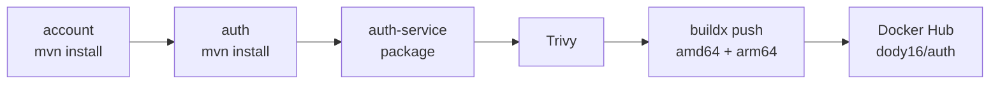
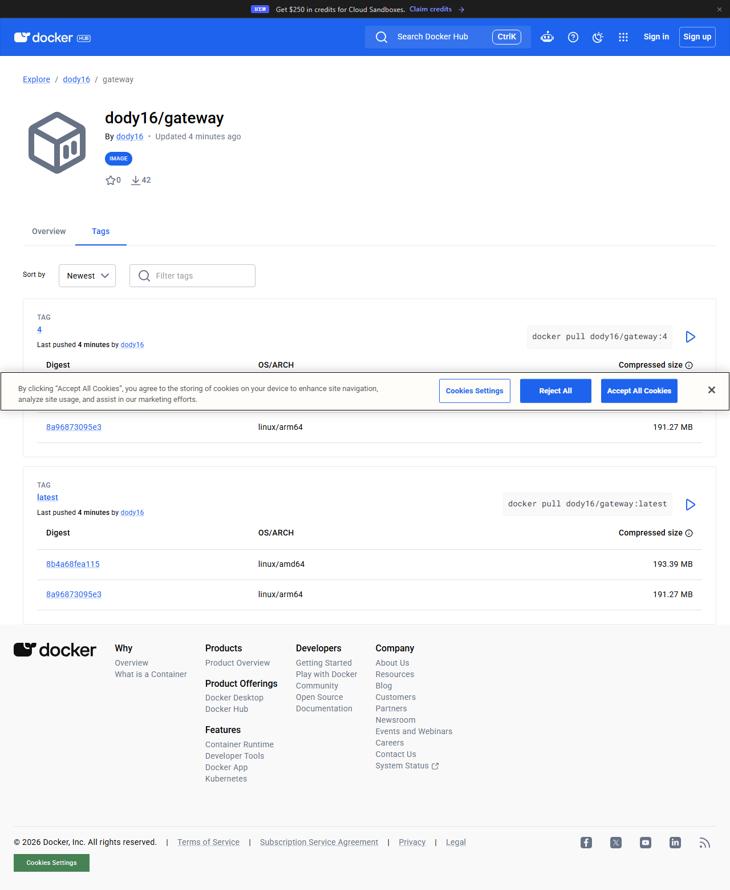
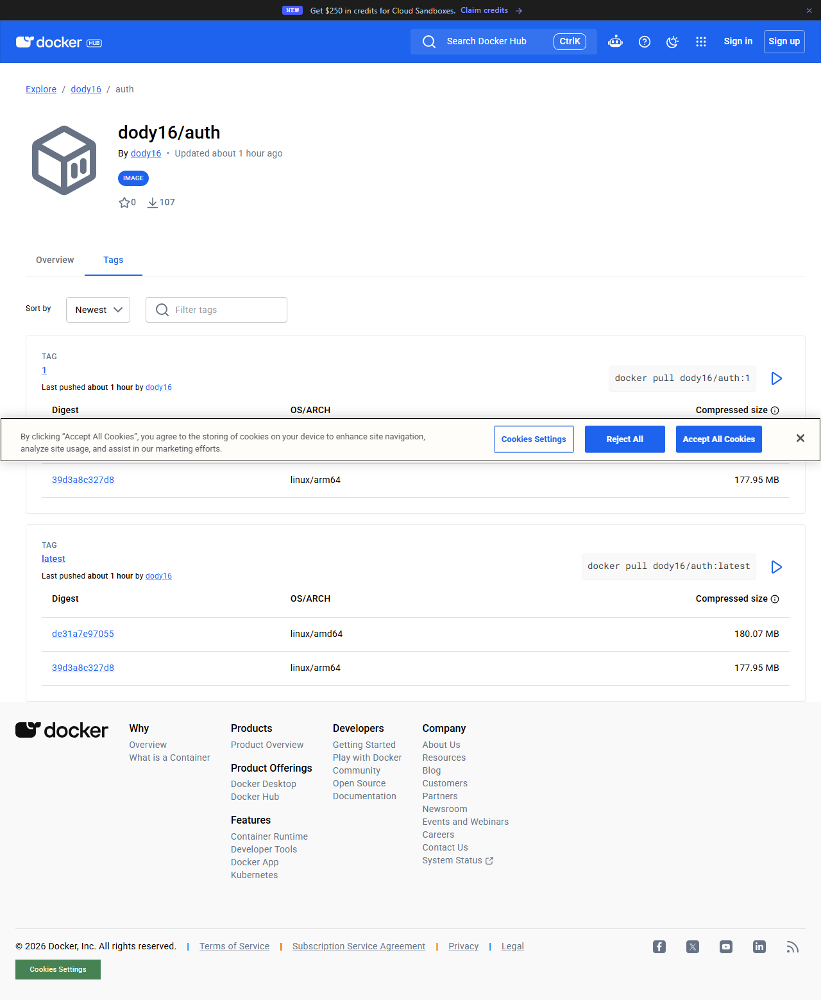

# CI/CD com Jenkins

!!! info "Parte do grupo"
    O Jenkins e os pipelines do Gateway e do Auth são do Douglas Celestino; os pipelines do `account-service` e do `exchange-service` são meus. Esta página é a da documentação do grupo.

O Jenkins roda em container (`jenkins/compose.yaml`), em `http://localhost:9080`, sobre a imagem `jenkins/jenkins:jdk25` com Maven, Docker, kubectl e AWS CLI, como no hands-on 4. O socket do Docker do host é montado no container, então os pipelines montam imagens no Docker da máquina.

``` bash
cd jenkins
docker compose up -d --build
```

## Jobs

Cada repositório tem um `Jenkinsfile` na raiz e um job do tipo *Pipeline script from SCM*:

| Job | Repositório | Estágios |
|---|---|---|
| `account` | pma-account | Build (`mvn install`) |
| `auth` | pma-auth | Dependencies (`account`), Build (`mvn install`) |
| `auth-service` | pma-auth-service | Dependencies (`auth`), Build, Scan Image, Build & Push Image |
| `gateway-service` | pma-gateway-service | Build, Scan Image, Build & Push Image |
| `account-service` | pma-account-service | Dependencies (`account`), Build, Scan Image, Build & Push Image |
| `exchange-service` | pma-exchange-service | Test (`pytest` em contêiner), Scan Image, Build & Push Image |

O `exchange-service` é Python e a imagem do Jenkins não tem Python: o estágio `Test` roda o `pytest` num contêiner `python:3.12-slim`. O código entra pelo `stdin` (`tar`), porque o contêiner roda no Docker do host e não enxerga o workspace, que só existe dentro do container do Jenkins.

O estágio `Dependencies` dispara o job da biblioteca antes (`build job: 'auth', wait: true`), garantindo que o jar da interface no `~/.m2` do Jenkins está atualizado. Por isso o número de executores sobe para 10: com 2, um job ocupa o executor esperando o outro e o pipeline trava.



## Credenciais

| ID | Uso |
|---|---|
| `dockerhub-credential` | login no Docker Hub (token de acesso, não a senha) |
| `github-credential` | clonar os repositórios privados da organização |

Os valores ficam no cofre do Jenkins e aparecem mascarados nos logs.

## Imagens publicadas

`dody16/account`, `dody16/auth`, `dody16/gateway` e `dody16/exchange` no Docker Hub, com as tags `latest` e o número do build. São as imagens usadas pelo deploy no EKS.

## Evidências (2026-11-20)

| Job | Build | Resultado |
|---|---|---|
| `account` | #1 | SUCCESS |
| `auth` | #1 | SUCCESS (disparado pelo `auth-service`) |
| `auth-service` | #1 | SUCCESS, imagem `dody16/auth:1` e `:latest` no Docker Hub |
| `gateway-service` | #4 | Build, Scan Image e push de `dody16/gateway:4` e `:latest` |

Scan do Trivy no build #4 do Gateway, que liberou a publicação:

``` text
│ gateway:scan-4 (ubuntu 26.04) │  ubuntu  │        0        │
│ app.jar                       │   jar    │        0        │
│ usr/bin/pebble                │ gobinary │        0        │
```

Os builds #1 a #3 do Gateway falharam por configuração e servem de histórico: token do GitHub sem acesso à organização (403) e tempo esgotado no primeiro download da base do Trivy (956 MB), resolvido com um volume de cache (`trivy-cache`) e `--timeout 15m`.

### Logs completos e imagens

Logs dos builds, extraídos do Jenkins (credenciais aparecem mascaradas como `****`):
[gateway-service #4](evidencias/jenkins-gateway-service-4.log),
[auth-service #1](evidencias/jenkins-auth-service-1.log),
[auth #1](evidencias/jenkins-auth-1.log),
[account #1](evidencias/jenkins-account-1.log).




