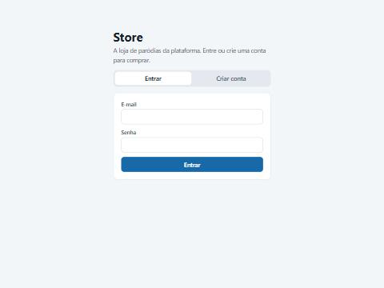
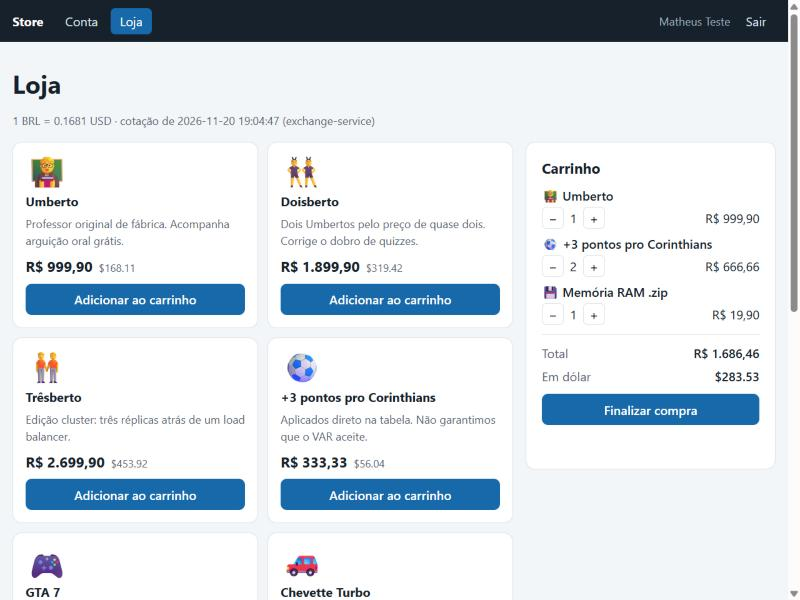

# Front-end: a loja

Código em `web/app`: HTML, CSS e JavaScript sem framework, servidos por um nginx (`web/compose.yaml`) em `http://localhost`. Segue a estrutura do `web/` do repositório da disciplina.

``` bash
cd web
docker compose up -d     # http://localhost
```

Toda chamada vai para `http://localhost:8080` (o load balancer, que repassa ao Gateway) com `credentials: 'include'`, para o navegador enviar o cookie JWT. O front-end nunca fala direto com um microsserviço.

## Páginas

| Página | Acesso | Conteúdo |
|---|---|---|
| `index.html` | aberta | entrar ou criar conta; depois de criar, já faz login |
| `conta.html` | exige sessão | dados da conta e a demonstração do cache Redis |
| `loja.html` | exige sessão | produtos, carrinho, compra e histórico |

Ao abrir `conta.html` ou `loja.html`, o `store.js` chama `GET /auth/me`. Sem sessão (`401`), a página volta para `index.html`; o conteúdo só aparece depois dessa checagem. Quem já está logado e abre `index.html` vai direto para a Conta. O botão **Sair** chama `GET /auth/logout`, que apaga o cookie.

A proteção de verdade continua no Gateway: mesmo que alguém abra o HTML, toda chamada à API sem cookie válido recebe `401`.



## Conta: o cache em ação

Mostra nome, e-mail e id, e dois botões:

- **Consultar minha conta 5×**: 5 chamadas a `GET /accounts/{id}`;
- **Consultar conta inexistente**: 1 chamada com um id que não existe.

Antes e depois de cada chamada, a página lê `GET /accounts/actuator/prometheus` e compara o contador `cache_gets_total{cache="accounts"}`: se subiu o `hit`, a resposta veio do Redis; se subiu o `miss`, veio do Postgres. A tabela mostra a origem, o status e o tempo de cada chamada, e os totais mostram a taxa de acerto. Detalhes e evidência em [Bottlenecks](bottlenecks.md#caching-matheus).

## Loja

Dez produtos paródia, com preço em reais e em dólares:

| Produto | Preço |
|---|---|
| Umberto | R$ 999,90 |
| Doisberto | R$ 1.899,90 |
| Trêsberto | R$ 2.699,90 |
| +3 pontos pro Corinthians | R$ 333,33 |
| GTA 7 | R$ 499,90 |
| Chevette Turbo | R$ 15.990,00 |
| Ocultador de vibe code | R$ 79,90 |
| Memória RAM .zip | R$ 19,90 |
| Dia de spa com o Gabriel | R$ 249,90 |
| Vesícula seminova | R$ 1.200,00 |

- O preço em dólar usa a cotação do [Exchange](exchange.md): `GET /exchanges/BRL/USD`, mostrada no topo da página com a data. Se o Exchange falhar, a loja segue com os preços só em reais.
- Carrinho com `+`/`−`, total em BRL e USD e **Finalizar compra**, que gera o número do pedido.
- O catálogo fica no `store.js` e o histórico de compras no `localStorage` do navegador (por conta). Não há serviço de produtos ou pedidos: um serviço novo precisaria de uma rota nova no Gateway, e o escopo do projeto é Gateway, Auth, Account e Exchange.



## Dois bugs de CORS encontrados na integração

Com a web em `http://localhost` e a API atrás do load balancer, o navegador bloqueava as chamadas. Foram dois problemas diferentes:

1. **nginx do load balancer.** `proxy_set_header Host $host` repassava `Host: localhost`, sem a porta. O Gateway comparava a origem `http://localhost` com esse host, concluía que era a mesma origem e não enviava `Access-Control-Allow-Origin`. A correção foi usar `$http_host`, que mantém `localhost:8080`. Origens fora da lista continuam recebendo `403`.
2. **`@CrossOrigin` no Account.** Com o CORS do Gateway corrigido, `GET /accounts/{id}` ainda dava `403 Invalid CORS request`: o Gateway repassa o header `Origin`, e uma anotação antiga no `AccountResource` só aceitava `localhost:3000`. Ela foi removida, e o CORS ficou só no Gateway ([pma-account-service#4](https://github.com/insper-plat-projeto/pma-account-service/pull/4)).

## Testes no navegador (2026-11-20, stack completa)

| Teste | Resultado |
|---|---|
| abrir `loja.html` sem login | volta para `index.html` |
| criar conta | entra direto na Conta |
| cache: minha conta 5× + id inexistente | 5 HIT (Redis) + 1 MISS (`404`) |
| loja | cotação 1 BRL = 0,1681 USD; carrinho de 4 itens = R$ 1.686,46 / $283.53; pedido confirmado e listado em "Minhas compras" |
| Sair e abrir `loja.html` | volta para `index.html` |
| senha errada | "E-mail ou senha inválidos." |
| celular (375 px) | sem rolagem horizontal |
